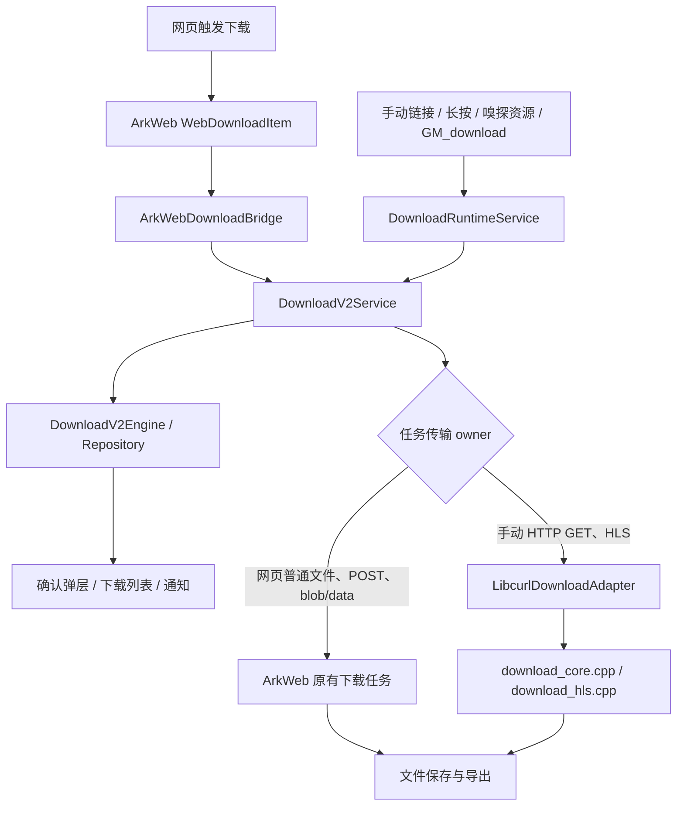

# Aira Browser 下载架构

更新日期：2026-10-24。本文描述当前源码与本地自动回归覆盖，替代旧版下载架构调研。

## 1. 当前结构

下载只有两个实际传输 owner：ArkWeb 和内置 libcurl。`DownloadV2Service` 负责建任务、确认、
排队、持久化和恢复；下载列表与弹层消费任务状态，不自行发网络请求。



网页下载以 ArkWeb delegate 的 `WebDownloadItem` 为依据。已经由浏览器发起的普通下载保留原请求，
避免把一次性地址重新 GET。`onDownloadStart` 不是另一个自动建任务入口。
HLS 需要清单、密钥和分片处理，因此使用原生 HLS 路径。

## 2. 请求与资源发现

资源嗅探来自网络证据、DOM、媒体元素和站点适配；发现或能播放某资源，不等于能够导出文件。
`MediaCandidateProjector` 负责资源操作投影，`BrowserMediaDiscoveryCoordinator` 构建下载请求。

- 已确认的 HLS 候选传入 HLS MIME，URL 无 `.m3u8` 后缀或服务器报告 `text/plain` 时仍走 HLS。
- 捕获的 Cookie、Authorization、Referer、Origin 和 User-Agent 随请求传递；已有头优先于兜底值。
- 长按下载在菜单打开时保存来源页面和页面 UA，选择时不会借用后来切换到的页面。
- 缺少 Cookie 时，libcurl adapter 按目标 URL 和任务的普通/私密边界读取 ArkWeb Cookie。
- 捕获的 Host、Range、If-Range、缓存条件和传输控制头不会作为新下载的固定请求头重放。
- DRM、DASH 和明确的音视频分离候选不提供文件下载动作；AES-128 identity HLS 不按 DRM 拦截。

## 3. 手动下载不预探测 HTML

任务创建前不再运行单独的 NetStack GET、HTML 跳转解析或 Range 探测。
这些请求曾提前消耗一次性链接，也把响应 Cookie、代理和身份拆成不同传输上下文。
HTTP 3xx 重定向与响应 Cookie 由实际下载器在同一任务中处理。

长按“下载链接”、手动 URL 和 `GM_download` 保存所选 URL 返回的资源。
如果响应是 HTML，就保存 HTML，不执行其中的 JavaScript 或 meta refresh。
需要页面脚本跳转才能获得文件时，应正常打开页面，由 ArkWeb 执行导航并识别最终下载响应。
这也适用于 MIME 已知为 HTML、没有附件声明的一次性地址。

## 4. 协议与媒体边界

| 类型 | 当前行为 |
| --- | --- |
| 网页 HTTP/HTTPS 文件 | ArkWeb 完成已经发起的请求 |
| 网页 POST 导出、blob/data | 保留 ArkWeb 请求与渲染器上下文 |
| 手动 HTTP/HTTPS GET | libcurl 下载，支持应用代理与标准 HTTP 重定向 |
| 普通 MP4/WebM 等直接文件 | 按文件下载，不需要媒体清单合并 |
| HLS VOD | 下载清单、初始化段与媒体段，按计划顺序合并 |
| HLS AES-128 identity | 16 字节密钥、CBC、PKCS#7，支持显式 IV 和媒体序号 IV |
| HLS 密钥轮换、METHOD=NONE | 分段绑定密钥与 IV，允许后续恢复明文 |
| HLS BYTERANGE | 媒体段支持显式偏移及合法的同资源隐式偏移 |
| HLS EXT-X-MAP | 按出现顺序保留初始化段；其 BYTERANGE 要求显式偏移 |
| 加密初始化段 | 必须显式指定 IV |
| HLS 外置音轨、直播、嵌套主清单 | 明确失败，不报告完整下载成功 |
| SAMPLE-AES、非 identity DRM | 不支持，不尝试绕过保护 |
| DASH、分离音视频合并 | 下载未实现；媒体发现/播放能力不能代替下载支持 |
| FTP/FTPS、magnet、ed2k、BitTorrent、RTMP | 当前没有对应的下载实现；libcurl 仅启用 HTTP/HTTPS |

HLS 主清单目前选择最高 BANDWIDTH 的变体。若该变体依赖独立音轨，拒绝导出无声的半成品。
清单相对地址以 HTTP 重定向后的最终清单 URL 为基准，根清单和变体清单都如此。

HLS 合并是有序资源拼接，不是通用媒体转封装器。含 MAP 的结果使用 `.mp4`，其他 HLS 使用 `.ts`。
不同编码参数、轨道变化或时间戳不连续的真实媒体播放兼容性，仍需独立验证；字节完整不等于所有播放器可播。

## 5. Cookie、重试与文件完整性

原生任务有自己的 Cookie 会话。响应 Set-Cookie 会进入后续 HTTP、清单、密钥与分片请求。
并行 HLS worker 各自使用 easy handle，复制 Cookie 快照并合并变化，不跨线程共用 libcurl Cookie jar。

从 ArkWeb 捕获的 Cookie 没有完整作用域元数据，按原主机导入，不作为任意 HLS 域名的固定头发送。
Authorization 只传给原 origin 的直接资源请求；跨域重定向遵守 libcurl 的认证转发限制。
普通与私密 Cookie 的选择保存在任务快照中，轮询和重试不会丢失隐私边界。

普通文件续传需要有效的本地强 ETag 记录，发送 Range 与 If-Range，并验证返回的范围和实体。
没有可靠验证器、服务器忽略范围或实体改变时，从头下载，避免把两个版本拼接为“完成”的文件。
续传记录同时绑定原地址与重定向后的最终资源地址。最终地址改变时，即使两个资源恰好使用相同
ETag，也会重新下载。旧版缺少最终地址的记录保留文件但不直接拼接。

普通 GET 默认最多进行三次暂时故障尝试；实体校验失败还允许一次干净的完整重下。
连接中断、临时服务器错误和限流使用有上限的退避，HTTP 与 HLS 都遵守 `Retry-After`。
服务器要求等待超过 30 秒时停止自动尝试并保留失败状态，等待期间的取消和暂停可中断等待。
访问拒绝、证书校验失败和本地写入错误不作盲目自动重试。

只有最终 2xx 响应可以作为普通文件完成；缺少有效目标的 3xx 和无缓存实体的 304 都不能当成文件。
文件缓冲区写入及关闭失败会报告写入错误，HLS 分片和最终合并同样检查落盘结果。
HLS 只有下载并解密成功的资源进入 checkpoint；计划、最终清单地址或密钥变化会使旧 checkpoint 失效。
错误密钥长度、IV、填充和字节范围会失败，不把不完整产物标为成功。

## 6. ArkWeb 恢复与队列

任务持久化明确保存传输 owner。ArkWeb 项使用 `WebDownloadItem.serialize()` 的上下文 token，
通过 `deserialize()` 与 `WebDownloadManager.resumeDownload()` 恢复；token 带版本并核对 GUID。

网页下载默认通过原有 ArkWeb 上下文恢复。上下文缺失、损坏或已失效时报告无法恢复，
让用户从原页面重新发起，避免丢失 POST、blob、一次性地址或会话信息。
冷启动重连不会自行发送网络请求；恢复仍经过下载队列与网络策略。
状态转换先于可能同步回调的启动操作，避免同步完成被之后的“开始”状态覆盖。
开始任务时先同步占用运行名额，再等待平台启动；adapter 合并同一任务尚未完成的启动请求。
原生模块仍在加载时收到取消或暂停，不会在加载完成后补发网络请求；再次暂停会撤销仍在等待中的恢复。
启动的第一个回调中取消时，操作实际创建的 native handle。用户继续暂停任务时也经过同一
队列与网络准入；排队恢复意图持久化为 `queued_live_resume`，暂停回调不会把它退回手动暂停。
原生已下载字节以当前传输实际字节为准，完整重下时允许归零；HLS 清单大小不作为整个视频总大小。
HLS 百分比按清单中的资源完成比例计算，已知长度的在途分片也贡献部分进度。成功分片的平均大小
用于估算总大小，初始化段单独统计，界面明确标注“预计”；估值不写入真实总大小或完整性校验字段。
下载列表、最近下载、工具栏和系统通知使用相同进度来源。重试撤回丢弃分片的进度，恢复时从有效
checkpoint 重建统计，合并文件成功关闭后才显示 100% 与实际大小。

普通 HTTP/HTTPS GET 已收到部分文件、已知完整长度且最终被 ArkWeb 以 `NETWORK_FAILED (20)`
中断时，自动切换一次 libcurl HTTP/1.1 单流下载。此处处理内核 HTTP/2/并行范围请求失败后反复恢复
仍失败的情况；初次网页请求继续由 ArkWeb 持有。POST、blob/data、访问拒绝和未收到文件的任务
不适用此恢复规则。切换保留原请求的 UA、Referer、已捕获请求头和 Cookie 隐私边界，并遵守队列准入。

ArkWeb 的 receivedBytes 可能是多段稀疏文件的字节总和，不能当作连续续传偏移。
兼容恢复使用独立临时文件，从零开始，持久化新 owner 和预期完整长度；旧 ArkWeb 事件被忽略。
替换响应只有与原文件长度相符才可完成，避免 CDN 的小体积 HTML 验证页被作为 APK 导出。
若替换下载仍失败，保留失败状态与重试入口，不继续自动循环恢复。

## 7. 保存与代码归属

`DownloadFileResolutionService` 与 `DownloadLocationDirectoryService` 负责目标目录、授权、导出及清理。
普通下载可使用默认系统下载位置或用户选择的目录；私密下载遵守其任务边界与保存策略。
传输完成、导出成功和最终可见路径是不同事实，列表应显示实际保存结果。
每个临时文件使用独立 UUID，避免同名任务在同一毫秒建任务时共用一个文件。
导出分配在应用内预留目标 URI，避免多个任务或窗口同时选中同一个尚不存在的文件名。
描述符复制会处理短写，写完当前数据块之后再移动源文件偏移。

关键代码均位于 `AiraBrowser/entry/src/main/`：

- `ets/services/downloadv2/DownloadV2Service.ets`：任务编排、owner、队列、恢复。
- `ets/core/downloadv2/DownloadV2Engine.ets` 与 `ets/domain/downloadv2/`：任务模型、状态机。
- `ets/platform/download/ArkWebDownloadBridge.ets`：ArkWeb delegate、原请求与恢复 token。
- `ets/platform/download/LibcurlDownloadAdapter.ets`：原生任务调用、请求上下文、进度轮询。
- `cpp/download_core.cpp`、`cpp/download_hls.cpp`：HTTP、续传、Cookie、HLS 计划与解密。
- `ets/services/media/` 与 `ets/core/browser/media/`：资源证据、能力投影和下载入口。
- `ets/data/downloadv2/` 与 `ets/services/download/`：持久化、目录、文件与隐私策略。

## 8. 验证方式与证据范围

```sh
./scripts/check-aira-downloads.sh
# 下列单项也可独立执行：
./scripts/check-download-native.sh
./scripts/check-download-proxy.sh
node scripts/check-aira-download-redirect-request.cjs
node scripts/check-aira-download-request-context.cjs
node scripts/check-aira-resource-download-context.cjs
node scripts/check-aira-arkweb-download-recovery.cjs
node scripts/check-aira-download-directory-lifecycle.cjs
node scripts/check-aira-download-export-ghost-guard.cjs
AIRA_DISTRIBUTION=community SKIP_INSTALL=1 ./scripts/build-aira-browser.sh
```

原生回归编译生产 C++，运行本地 HTTP fixture，断言产物字节、失败状态、Cookie 和范围请求。
AES fixture 由独立 OpenSSL 实现生成，解密使用仓库内的 Mbed TLS。
ArkTS 回归执行生产方法，平台对象、存储和调度使用受控模型；一次性下载测试实际经过 V2 创建到本地 HTTP。
这些检查不能替代 HarmonyOS 真机的 ArkWeb token 生命周期、TLS/系统证书、系统保存权限和真实媒体播放验证。
本次工作没有进行设备截图、设备安装或真实站点端到端验收。

完整下载检查由 `scripts/check-aira-downloads.sh` 统一执行，并用于客户端 CI 和本地整包构建。
新增故障注入覆盖模块加载期间取消/重复启动、排队恢复、同步完成、短写与同名文件竞争、
HTTP 临时断连/限流/服务暂不可用、错误重定向/304、实体切换，以及 HTTP/HLS 缓冲落盘失败。
原生旧有手动续传检查使用单次传输模式，另由故障注入验证生产默认的自动恢复路径。

协议依据：[RFC 8216](https://www.rfc-editor.org/rfc/rfc8216.html)、
[libcurl Cookie engine](https://curl.se/libcurl/c/CURLOPT_COOKIEFILE.html)、
[libcurl Retry-After](https://curl.se/libcurl/c/CURLINFO_RETRY_AFTER.html)、
[Huawei WebDownloadItem](https://developer.huawei.com/consumer/cn/doc/harmonyos-references/arkts-apis-webview-webdownloaditem)、
[Huawei WebDownloadManager](https://developer.huawei.com/consumer/cn/doc/harmonyos-references/arkts-apis-webview-webdownloadmanager)。
