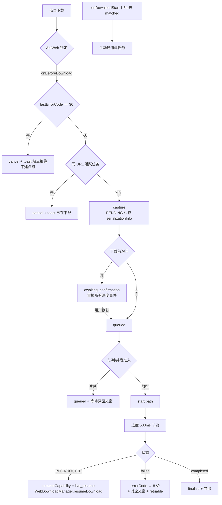

# Aira Browser 下载功能对齐华为浏览器架构分析

> **历史草稿，已被重新核验结果取代（2026-11-17）。** 下文保留调查过程，不再作为实施依据。
> 关于网络失败/自动恢复、startPhoneDownload 独立兜底、权限不可重试、PENDING 可恢复、文件名上限及原生符号能力的多处断言已纠正。
> 事实与证据请先读 [REA 重新分析](aira-browser-download-rea-reanalysis.md)，实施仅使用 [新版规格](aira-browser-download-parity-spec.md)。原生符号存在不等于公开 API 契约或实际运行行为。

日期：2026-11-17

## 1. 本文范围

本文只基于本地华为浏览器样本与本地 Aira 源码分析，不使用网络资料。

本地华为样本与既有分析：

- `<local-huawei-browser-research>/HuaweiBrowser-phone.hap`（`com.huawei.hmos.browser` 5.1.9.315，versionCode 50109315，API target 50101019）
- `<local-huawei-browser-research>/modules.pa`（`ets/modules.abc` 经 `ark_disasm` 反汇编，162 MB / 117,415 个函数）
- `<local-huawei-browser-research>/华为浏览器下载实现分析.md`（本文第 3 节的原始还原记录）

本文重点回答三个问题：

1. 华为浏览器的下载功能是怎么组织的，一套完整链路包含哪些环节。
2. Aira 当前的下载实现已经做到了什么，哪些地方比华为更好。
3. 要让 Aira 对齐华为，具体缺什么、按什么顺序补。

本文与既有文档的关系：

- **`aira-browser-download-parity-spec.md` 是最终实施规格（行为等价 + 待执行任务清单）**，已包含本文 §5 的全部条目并补充了 D1/D2/D3 三条已定决策。要改代码时以 parity spec 为准，本文作为背景与证据来源保留。
- `aira-browser-download-current-architecture.md` 描述 Aira 当前结构，仍然有效，本文不重复。
- `aira-download-folder-permissions-diagnosis.md` 描述保存目录权限问题，是本文 P0-1（错误分档）的一个具体场景。
- `aira-browser-download-huawei-rea-verification.md` 是用 REA 对同一份 HAP 做的原生层复核，证实了本文第 3 章的三条关键推断，并在原生符号层面补充了「冲突策略与续传校验器必须在 `start()` 之前确定」这一约束。本文 P1-1 与 P1-3 的改法已按该结论修正。

---

## 2. 结论

### 2.1 一句话

Aira 的下载**架构**已经比华为规范（显式状态机、双传输驱动、进度未知一等公民、触发诊断），真正缺的是华为在边界上补的兜底。按影响排序共 **8 个缺口**：2 个 P0、3 个 P1、3 个 P2；其中 P0-1 与 P0-2 直接对应「下载错误」和「点击没反应」这两个用户感知问题，且改动最小。

### 2.2 速览

| 用户症状 | 华为的做法 | Aira 现状 | 差距 |
| --- | --- | --- | --- |
| 点击下载没反应 | `onBeforeDownload` 里只有两个出口：`start(path)` 或 `cancel()`；item 用 `Map<guid,item>` 强引用；另有 `startPhoneDownload` 独立于 delegate 的兜底通道 | `onDownloadStart` 只记录 UA，delegate 没来就什么都不发生 | **P0-2** |
| 下载错误提示不可用 | 20+ 个 `WebDownloadErrorCode` 归一化成 4 类（网络/权限/存储/其它），各自文案与可重试性；`36 SERVER_FORBIDDEN` 在入口拦截不建任务 | `code: 'unknown'` 统一吞掉，UI 显示 `Download failed, error 20` | **P0-1** |
| 重启后续不上 | 从 `onBeforeDownload` 起就 `safeSetSerializationInfo(item)` 落库，任何阶段都能恢复 | PENDING 状态 `serialize()` 直接返回 `undefined`，重启后恢复必然失败 | **P1-1** |
| 下载时卡 / 进度条一顿一顿 | 进度落库 500 ms 节流 + 状态变化穿透 + 只写变化行 | 250 ms 轮询 × 每事件全量落盘 × 每次 `JSON.stringify` 打 hilog | **P1-2** |
| 「下载前询问」不可靠 | PC 端在 `onBeforeDownload` 里先 `task.pause()`，确认后再 `start()` | `awaiting_confirmation` 会被 PENDING 的 `updated` 事件推成 `queued` | **P1-3** |
| 断点被判成真失败 | `INTERRUPTED` 与真失败分开，走 `WebDownloadManager.resumeDownload` | `INTERRUPTED` 被映射成 `'FAILED'` | **P2-1** |
| blob / data 下载 | `data:` 自己 base64 解码写盘；`blob:` 从 WebView 缓存取内容 | 全部交给 ArkWeb `item.start()`，没有第二方案 | **P2-2** |
| 重复点击 | `checkDownloadTaskIsExist` + toast | 有文件名冲突服务，但没有「同 URL 已在下载」提示 | **P2-3** |

### 2.3 明确不要照搬的部分

| 华为做法 | 为什么不抄 |
| --- | --- |
| `MAX_PARALLEL_TASK_NUMBER = 3` 写死在类字段 | Aira 的 `DownloadQueuePolicyService` 可配置且与网络策略合并，更好 |
| `progressValue = percent === -1 ? 0 : ...` | Aira 的 `progressKnown` / 通知 `isPercentage: false` 才是正确的不确定态 |
| `resume()` / `resumeDownload()` 靠 `catch` 猜 | Aira 有 `resumeCapability: none / retry_only / live_resume` 显式判定 |
| 9 个 `DownloadState` 压平成 6 个按钮态 | Aira 9 态直出、VM 层派生，信息不丢 |
| 下载逻辑与 UI 混在 `DownloadLogic` 单例里（30000 行 .pa） | Aira 的 Service / Engine / Repository 分层是正确方向 |

---

## 3. 华为浏览器怎么做

### 3.1 分层结构

**引擎归属**：网页下载的引擎不在应用包里，而是系统组件 **ArkWebCore** 里的 **Chromium `components/download`**（`libarkweb_engine.so`，UA 串 `Chrome/144.0.7559.59`，保留 `components/download/internal/common/download_item_impl.cc`、`parallel_download_job.cc`、`download_path_reservation_tracker.cc` 等源文件路径；华为在其上加了 `arkweb_download_*_ext.cc` 扩展，即 NAPI 的落点）。应用侧的 `libbrowser_service.so` 只是绑定层。定位方法与三个下载引擎的分工见 `aira-browser-download-huawei-rea-verification.md` §4.0。

```
网页触发（a[download] / Content-Disposition: attachment / MIME 不可渲染 / 302 到附件）
        │
        ├─ WebviewController.setDownloadDelegate(delegate)    controller 级，每个 Web 组件各一份
        └─ WebDownloadManager.setDownloadDelegate(delegate)   manager 级，全局一份
                        │
        BrowserWebDownloadDelegate（4 个回调）
        ├─ onBeforeDownload   → onBeforeDownloadStartByPage / ...ByWebview
        ├─ onDownloadUpdated  → handleProgress（500 ms 节流）
        ├─ onDownloadFinish   → onDownloadFinish
        └─ onDownloadFailed   → conversionFailState → onDownloadFailed
                        │
        DownloadTaskManagerImpl（单例）
        ├─ _runningTaskSet / _runningTaskMap    最多 3 个并发
        ├─ _waitingTaskQueue（PromiseQueue）
        └─ _downloadAgainOriginInfoMap
                        │
        DownloadTask（包一层 WebDownloadItem）+ DownloadInfo（RDB 行）
                        │
        ├─ 下载列表 / 工具栏（DownloadInfoUIModel + DownloadLogic 观察者）
        ├─ 通知（downloadTemplate / progressValue）
        └─ 后台长时任务（backgroundTaskManager.startBackgroundRunning，DATA_TRANSFER）
```

源码结构（从 `modules.pa` 的模块路径还原）：

```text
entry/src/main/ets/pages/components/webpage/WebComponentController.ets   delegate 挂载 + startPhoneDownload
hwbr/download/src/main/ets/Index.ets                                     下载扩展入口
hwbr/download/src/main/ets/DownloadApiImpl.ets                           对外 API（进度聚合、红点）
hwbr/download/src/main/ets/longTask/DownloadLongTaskHelper.ets            后台长时任务
hwbr/logic/src/main/ets/logic/download/DownloadLogic.ets                  单例门面
hwbr/logic/src/main/ets/logic/download/delegate/BrowserWebDownloadDelegate.ets   ★ 核心
hwbr/logic/src/main/ets/logic/download/impl/DownloadTaskManagerImpl.ets    ★ 并发/启动/恢复
hwbr/logic/src/main/ets/logic/download/model/DownloadInfoUIModel.ets      UI 模型 + 状态压平
hwbr/logic/src/main/ets/logic/download/utils/DownloadFileUtils.ets        目录/命名/冲突/安全校验
hwbr/logic/src/main/ets/logic/download/utils/WebDownloadDelegateUtils.ets 给 manager 装 delegate
hwbr/logic/src/main/ets/logic/download/utils/DownloadNotificationUtils.ets 通知
hwbr/logic/src/main/ets/database/dao/DownloadInfoDao.ets                  表 download_info
hwbr/sdk/src/main/ets/download/model/DownloadTask.ets                     对 WebDownloadItem 的封装
hwbr/sdk/src/main/ets/download/model/DownloadTaskInfo.ets                 全部枚举
```

> `libs/arm64-v8a/libnetwork-download.so` 是 HMS NetworkKit 的原生下载，**网页下载不用它**，只被 `HttpUtils` 用于业务资源下载。

### 3.2 `onBeforeDownload` 的四个分支

```text
onBeforeDownload(item):
  ① if (item.getLastErrorCode() === 36 /* SERVER_FORBIDDEN */)
         → toast ; return                        // 不建任务，不留失败记录
  ② task = new DownloadTask(item)                // 封装
     existed = await repo.queryById(task.getId())
  ③ if (existed) {                               // 同一 guid 重入
         task.pause()
         downloadManager.notifyStartByAbnormal(...)
         return
     }
  ④ info = downloadManager.createDownloadTaskInfo(task, isIncognito)
       // 里面同时做：generateDownloadId / convertDownloadState
       //            getUriFromPath(getFullPath())
       //            totalLength / downloadedLength / fileName / mimeType / startTime
       //            serializationInfo = safeSetSerializationInfo(item)   ★ 关键
       //            mode = NORMAL | INCOGNITO
       //            notifyAll([info], CREATE)
  ⑤ if (isPcDevice()) task.pause()               // PC：先暂停，等用户确认/选目录
     else await prepareDeeplink(info)            // 手机：判断是否该交给 App
  ⑥ callback(info) → addDownloadTaskByWebView
```

原生侧证据（`libbrowser_service.so` 导出表，见 `aira-browser-download-huawei-rea-verification.md` §4）：`WebDownload_PauseBeforeDownload` / `WebDownload_CancelBeforeDownload` / `WebDownload_ResumeBeforeDownload` 是与常规动作**并列独立**的一族，`WebDownloadItem_ETag` / `SetETag` 与 `WebDownloader_SetFileRenameOption` 也都是独立的 setter。说明「下载开始前」在原生层是一等公民：既可以被暂停，也可以被取消，冲突策略必须在 start 之前设好。

`DownloadTask.start()` 与 `resume()` 的实现（这两个是「没反应」的高发点）：

```ts
start(uri: string) {
  const item = this.webOnBeforeDownloadItem ?? this.webDownloadItem;
  try {
    item.start(new FileUri(uri).path);        // ★ 传文件路径，不是 file:// URI
  } catch (e) {
    logger.error(`start download item error, code = ${e.code}`);
    item.start(uri);                          // 兜底
  }
}

resume() {
  try {
    // ★ 两个 API 分场景，混用必然失败
    if (!this.isNeedResumeDownload()) webview.WebDownloadManager.resumeDownload(this.webDownloadItem);
    else this.webDownloadItem.resume();
  } catch (e) { logger.error(`resume error msg:${e.msg}`); }
}

isNeedResumeDownload() {
  return this.webDownloadItemSource === WebDownloadItemSource.UnSerialize
      || item.getState() === WebDownloadState.CANCELED
      || item.getState() === WebDownloadState.INTERRUPTED;
}
```

### 3.3 落盘路径决策

```text
addDownloadTaskByWebView(item, info):
  chooseFolder = settings.getBoolean(CHOOSE_DOWNLOAD_FOLDER)
  then(dir => {
     uri = UrlLogic.getFragment(info.url)
     support = DownloadFileUtils.isSupportDownloadChooseFolder(chooseFolder, uri, apiLevel)
     downloadManager.determineDownloadPathBeforeStart(info, item, support)
        .then(path => {
            if (!path) { info.downloadTask?.cancel(); return }   // ★ 用户取消必须 cancel
            dir = path.substring(0, path.lastIndexOf('/'))
            downloadManager.addDownloadTask(info, true, tabId, dir, false)
        })
  })
```

`DownloadConstants` 关键常量：

```text
DOWNLOAD_DIR  = "/download"        // 拼在 context.filesDir 之后
TEMP_DIR      = "/web/Temp"        // ArkWeb 自己的临时目录
TEMP_NAME_RE  = /^\.org\.chromium\.Chromium\..*/   // 内核临时文件名
MAX_FILE_NAME = 2048               // 2 * 1024
```

### 3.4 启动与并发

```text
doStartImmediately(info):
  if (canExecuteImmediately(requestId)) {      // PC 无限制；手机 < 3
      _runningTaskSet.add(requestId)
      startAndResume(info)                     // task.start(uri) 然后 task.resume()
  } else {
      _waitingTaskQueue.push(...)
      info.state = Waiting
      info.pauseReason = canUseMobileData ? 0 : DOWNLOAD_ONLY_WIFI
      notifyAll([info], UPDATE) + db.update
  }
```

网络类型变化时 `onNetworkTypeChange` 会把 `DOWNLOAD_ONLY_WIFI` 的任务全部中断，回到 Wi-Fi 再 `resumeAllDownloadTask()`。

### 3.5 进度（`handleProgress`）

```text
if (!enabled) return
downloaded = item.getReceivedBytes() ?? 0
newState   = convertDownloadState(item.getState()) ?? 0
oldState   = ctx.downloadInfo?.state ?? 0

needFlush = now - ctx.lastUpdateTime > TIME_INTERVAL(500) || oldState !== newState
if (!needFlush) return

ctx.lastUpdateTime = now
ctx.downloadInfo.downloadedLength  = downloaded
ctx.downloadInfo.state             = newState
ctx.downloadInfo.serializationInfo = safeSetSerializationInfo(item)
ctx.downloadTask                   = item
ctx.downloadInfo.totalLength       = item.getTotalBytes()   // 可能 -1
downloadManager.updateDownloadTaskInfo(ctx)                 // 落库 + notifyAll
```

`getTotalBytes()` / `getPercentComplete()` 在服务端不给 `Content-Length`（chunked）时返回 **-1**。华为的处理是：进度条 `progressValue` 取 0，通知发出去但不带确定进度。

### 3.6 错误归一化（`conversionFailState`）

```ts
conversionFailState(errorCode) {
  if (errorCode === USER_CANCELED /*40*/)                      return 5; // Cancelled，静默
  if ([NETWORK_FAILED /*20*/, NETWORK_TIMEOUT /*21*/,
       NETWORK_DISCONNECTED /*22*/].includes(errorCode))       return 3; // Pause，可重试
  if (errorCode === FILE_ACCESS_DENIED /*2*/)                   return 7; // AccessDeny
  if (errorCode === FILE_NO_SPACE /*3*/)                        return 6; // Fail
  if (errorCode === NETWORK_INVALID_REQUEST /*24*/)             return 6; // Fail
  return 6;                                                             // Fail
}
```

失败收尾：

```text
if (state === Cancelled)  → Toast("下载已取消")
if (state === AccessDeny) → logger.error("download failed. access deny.") ; state = Fail
updateDownloadTaskInfo(info)     // 落库 + 通知 UI
```

### 3.7 状态与 UI 映射

业务状态（持久化）：

```ts
enum DownloadState {
  Init = 0, Waiting = 1, InProgress = 2, Pause = 3, Complete = 4,
  Cancelled = 5, Fail = 6, AccessDeny = 7, Deleted = 8
}
```

UI 按钮态只有 6 个，靠 `downloadStateToButtonState` 压平：

| DownloadState | DownloadButtonState |
| --- | --- |
| Init(0) | Waiting(4) |
| Waiting(1) | Waiting(4) |
| InProgress(2) | InProgress(0) |
| Pause(3) | Interrupted(3) |
| Complete(4) | Complete(1) |
| Cancelled(5) | Deleted(5) |
| Fail(6) | Cancelled(2) |
| AccessDeny(7) | Cancelled(2) |
| Deleted(8) | Waiting(4) |

另有 `PauseReason { NO_PAUSE, WAITING_EXCEEDS_LIMIT, PAUSE_MANUALLY, PAUSE_NETWORK_DISCONNECT, DOWNLOAD_ONLY_WIFI }`，决定文案与是否自动恢复。启动流水线另有 `NewDownloadState { Init, WaitForAppHead, WaitForServer, WaitForPrompt, WaitForNetworkConfirm, Started }` 用于应用市场引导。

### 3.8 文件命名与安全校验

```text
getSuggestFilenameFromWebDownload(item)   // 优先 item.getSuggestedFileName()
getSuggestFilename(url)                   // 兜底：URL 最后一段，去 query
getRealSuggestFileName(base, url)         // URL 真实后缀覆盖建议名后缀（解决 download.bin）
getFileNameWithinLimit(name)              // 截到 2048
unpackFileName(name)                      // 解 %xx、去非法字符
checkAndGenerateFileName(name, dir)       // name(1).ext
FilenameConflictAction { UNIQUIFY, OVERWRITE, PROMPT }
```

`checkDownloadUri` 的路径安全校验（防穿越）：

```text
1. 空 / "undefined"                                      → false
2. startsWith(parseFileUriToFilePath(docDir))            → true
3. /^\/storage\/Users\/currentUser(?!.*\/storage\/Users\/currentUser).*$/   → true
4. /^\/storage\/External(?!.*\/storage\/External).*$/                       → true
5. "file://media" 白名单                                 → true
6. statSync(uri) 成功                                    → true
```

### 3.9 持久化

表 `download_info` 列：

```text
id | request_id | uri | url | file_name | mime_type
total_length | downloaded_length | start_time | complete_time
serialization_info | pause_reason | mode | auth_type
```

`serialization_info` 存 `webDownloadItem.serialize()` 的结果，是断点续传的唯一凭据。`auth_type` 配合 `FilePickerUtils.activatePermissionURI()`：App 重启后 picker 授权失效，重试前必须重新激活，否则必然 `FILE_ACCESS_DENIED`。

### 3.10 `data:` / `blob:` 的特殊通道

这两类 URL 在 ArkWeb 里行为不稳定，华为各有一条独立兜底：

- `data:` → `DownloadLogic.dataUrlDownload`：`UrlUtils.getDataUrlInfo` 解析 → base64 解码 → `getDownloadPathFromPicker` → `addDownloadTaskNoWeb` → `saveFileFromCache` 直接写盘，全程不碰 WebView。
- `blob:` → `DownloadLogic.getImageFromCache`：用正则 `^blob:` 识别，从 WebView 缓存取内容（`getCacheValueFunc`），取不到再走 picker + 文件名推导。

---

## 4. Aira 当前实现

### 4.1 三个 owner

```text
① 触发层（6 个 source）
   arkweb_delegate : ArkWebDownloadBridge.ets:302-311
   on_download_start : HostedWebNode.ets:2583 → BrowserShellPage.handleDownloadStart → recordWebDownloadStart
   manual / resource_sniff / site_video / userscript
                    ↓ 统一进 DownloadTriggerDiagnosticsService（6 source × 6 phase，带 matched 标记）

② 传输层（双驱动）
   ArkWeb  : ArkWebDownloadBridge（controller 级 + manager 级 delegate 都已安装）
   libcurl : LibcurlDownloadAdapter（Range / ETag / 分段 / HLS，250 ms 轮询原生快照）
   driver 选择：DownloadV2Service.resolveInitialDownloadDriver（1090-1112）

③ 编排层
   DownloadV2Service（唯一编排者，2562 行）
     → DownloadV2Engine（唯一写入口）
       → DownloadV2StateMachine（9 态 × 12 事件，非法转移拒绝）
         → DownloadV2Repository → DownloadV2RecordStore（preferences 全量 JSON）
           → DownloadManagerViewModel / ToolbarIndicator / Notification
```

`controller.setDownloadDelegate` 在 `core/web/WebControllerBootstrapper.ets:19` 统一安装；`WebDownloadManager.setDownloadDelegate` 在 `ArkWebDownloadBridge.ets:300` 安装。两处都在，这点已经和华为对齐。

### 4.2 驱动选择规则（`resolveInitialDownloadDriver`）

```text
非 GET                → arkweb   （ArkWeb 不暴露 body，不能重放）
非 http(s)            → arkweb   （blob:/data: 只在渲染进程里有效）
平台已持有 URL 且非 HLS → arkweb   （签名 URL 重放会被 403）
HLS                   → libcurl （要并发拉分片）
其余                  → libcurl
```

### 4.3 状态机

9 态：`created / awaiting_confirmation / queued / running / paused / completed / failed / canceled / removed`。
12 事件：`create / await_confirmation / confirm / queue / start / pause / resume / finish / fail / cancel / retry / remove / hydrate`。

比华为多出 `awaiting_confirmation`（显式确认态）与 `removed`（记录删除与文件删除分离）。

### 4.4 进度未知态（Aira 更强的地方）

```ts
// domain/downloadv2/DownloadV2Progress.ets
resolveDownloadProgressFraction → fraction >= 0 ? clamp : (total > 0 ? received/total : -1)
```

- `-1` 表示不确定，`DownloadToolbarIndicatorViewModel` 借此产出 `progressKnown=false`；
- 通知侧 `progressDeterminate` → `isPercentage: false`，系统渲染不确定进度；
- 记录侧 `progressFraction` 单独持久化，HLS 分片进度与字节进度解耦。

这一层比华为的 `progressValue = 0` 更正确，应保留。

---

## 5. 差距清单

每条格式：现象 → 证据（文件:行）→ 华为做法 → 修法。

### 5.1 P0-1 错误码不分档

**现象**：下载失败后 UI 只显示 `download_status_failed_code = "Download failed, error %1$d"`，用户看到的是数字，无法区分网络抖动、权限、空间、服务端拒绝。

**证据**

```ts
// services/downloadv2/DownloadV2Service.ets:2399-2428
private buildFailureFromPlatformEvent(event, currentFailure): DownloadV2Failure {
  if (event.type === 'canceled' || this.isCanceledState(event.snapshot.state)) {
    return { code: 'canceled', sourceCode: event.snapshot.lastErrorCode, retriable: false, ... };
  }
  return {
    code: 'unknown',                    // ← 20 / 21 / 2 / 3 / 31 / 36 全部变 unknown
    sourceCode: event.snapshot.lastErrorCode,
    message: nativeMessage ?? $r('app.string.download_failed_file', fileName),
    retriable: true                     // ← 权限错误也被标成可重试
  };
}
```

而 `DownloadV2FailureCode`（`domain/downloadv2/DownloadV2Types.ets:19-28`）早已定义 9 类：

```ts
'none' | 'network' | 'server' | 'file_system' | 'permission' | 'context_lost' | 'unsupported' | 'canceled' | 'unknown'
```

全项目只有 `file_system`（1 处）与 `context_lost`（2 处）被使用，其余从未产出。libcurl 侧同样只透传 `nativeSnapshot.errorCode`（`LibcurlDownloadAdapter.ets:668`），没有分类。

**华为做法**：`conversionFailState` 归一化成 4 类 + `36 SERVER_FORBIDDEN` 在 `onBeforeDownload` 直接拦截。

**修法**

新增 `domain/downloadv2/DownloadV2FailureMapper.ets`：

```ts
import { webview } from '@kit.ArkWeb';
import { DownloadV2FailureCode } from './DownloadV2Types';

export interface DownloadV2FailureClassification {
  code: DownloadV2FailureCode;
  retriable: boolean;
}

/** ArkWeb WebDownloadErrorCode 全量分档，对应华为 conversionFailState 的扩展版。 */
export function classifyWebDownloadErrorCode(errorCode: number): DownloadV2FailureClassification {
  switch (errorCode) {
    case webview.WebDownloadErrorCode.USER_CANCELED:                  // 40
    case webview.WebDownloadErrorCode.USER_SHUTDOWN:                  // 41
      return { code: 'canceled', retriable: false };
    case webview.WebDownloadErrorCode.NETWORK_FAILED:                 // 20
    case webview.WebDownloadErrorCode.NETWORK_TIMEOUT:                // 21
    case webview.WebDownloadErrorCode.NETWORK_DISCONNECTED:           // 22
    case webview.WebDownloadErrorCode.NETWORK_SERVER_DOWN:            // 23
    case webview.WebDownloadErrorCode.SERVER_UNREACHABLE:             // 37
      return { code: 'network', retriable: true };
    case webview.WebDownloadErrorCode.FILE_TRANSIENT_ERROR:           // 10
    case webview.WebDownloadErrorCode.FILE_TOO_SHORT:                 // 13
    case webview.WebDownloadErrorCode.FILE_HASH_MISMATCH:             // 14
      return { code: 'file_system', retriable: true };
    case webview.WebDownloadErrorCode.FILE_ACCESS_DENIED:             // 2
      return { code: 'permission', retriable: false };
    case webview.WebDownloadErrorCode.FILE_NO_SPACE:                  // 3
    case webview.WebDownloadErrorCode.FILE_NAME_TOO_LONG:             // 5
    case webview.WebDownloadErrorCode.FILE_TOO_LARGE:                 // 6
    case webview.WebDownloadErrorCode.FILE_SAME_AS_SOURCE:            // 15
      return { code: 'file_system', retriable: false };
    case webview.WebDownloadErrorCode.FILE_BLOCKED:                   // 11
      return { code: 'unsupported', retriable: false };
    case webview.WebDownloadErrorCode.SERVER_NO_RANGE:                // 31
      return { code: 'server', retriable: false };
    case webview.WebDownloadErrorCode.SERVER_FAILED:                  // 30
    case webview.WebDownloadErrorCode.SERVER_BAD_CONTENT:             // 33
    case webview.WebDownloadErrorCode.SERVER_UNAUTHORIZED:            // 34
    case webview.WebDownloadErrorCode.SERVER_CERT_PROBLEM:            // 35
    case webview.WebDownloadErrorCode.SERVER_FORBIDDEN:               // 36
    case webview.WebDownloadErrorCode.SERVER_CONTENT_LENGTH_MISMATCH: // 38
    case webview.WebDownloadErrorCode.SERVER_CROSS_ORIGIN_REDIRECT:   // 39
    case webview.WebDownloadErrorCode.NETWORK_INVALID_REQUEST:        // 24
      return { code: 'server', retriable: false };
    default:
      return { code: 'unknown', retriable: true };
  }
}

/** 失败分类 → 用户文案资源。 */
export function resolveDownloadFailureMessageKey(code: DownloadV2FailureCode): string {
  switch (code) {
    case 'network': return 'download_failed_network';
    case 'permission': return 'download_failed_permission';
    case 'file_system': return 'download_failed_storage';
    case 'server': return 'download_failed_server';
    case 'unsupported': return 'download_failed_unsupported';
    case 'canceled': return 'download_canceled_message';
    default: return 'download_failed_file';
  }
}
```

`buildFailureFromPlatformEvent` 改用分类结果；`retriable` 直接取分类值，不再一律 `true`。

新增 5 条资源串（`entry/src/main/resources/base/element/string.json` 与 `en_US` 成对）：

```text
download_failed_network     = "下载失败：连接中断，请检查网络后重试。"
download_failed_permission  = "下载失败：无法写入保存目录，请更换目录。"
download_failed_storage     = "下载失败：存储空间不足。"
download_failed_server      = "下载失败：站点拒绝了该文件。"
download_failed_unsupported = "该文件不支持通过 Aira 下载。"
```

再在 `DownloadV2Service.consumePlatformEvent` 的 `before_download` 分支开头补华为的 36 拦截：

```ts
if (event.snapshot.lastErrorCode === webview.WebDownloadErrorCode.SERVER_FORBIDDEN) {
  this.platformAdapter.cancelPendingDownload(event.snapshot.guid);
  this.callbacks.onError?.(resolveAppResourceText($r('app.string.download_failed_server')));
  return true;
}
```

### 5.2 P0-2 `onDownloadStart` 有记录、无兜底

**现象**：`onDownloadStart` 触发了但 `onBeforeDownload` 没来（ArkWeb 判定为导航、被拦截器吞掉、blob/JS 触发、MIME 可渲染…），这条链在 Aira 里直接断掉，用户看到的是「点击没反应」。诊断记录里只留一条 `matched=false`。

**证据**

```ts
// app/pages/BrowserShellPage.ets:12227-12236
private handleDownloadStart(tabId: string, event: OnDownloadStartEvent): void {
  this.browserTabBackgroundSessionSyncCoordinator.markDownloadStarted(tabId);
  this.browserUserScriptApplicationCoordinator.handleInstallCandidate(event.url);
  this.downloadService.recordWebDownloadStart(...);   // ← 只记录 UA，无兜底
}
```

```ts
// services/download/DownloadTriggerDiagnosticsService.ets:78-84
if (event.type === 'before_download') {
  this.markMatchingOnDownloadStart(event.snapshot.url, timestamp);  // 只把记录标 matched
}
```

**华为做法**：`startPhoneDownload` / `startPcDownloadWithSaveAs` 是独立于 delegate 的通道（浏览器自己的下载按钮、长按菜单走这条），另有 `addDownloadTaskNoWeb` 支持完全手动的 URL。

**修法**：给 `recordWebDownloadStart` 加 1.5 s 定时器，到点仍未 matched 就用已记录信息走**现成的手动通道**（不新写下载逻辑）。

```ts
// services/download/DownloadRuntimeService.ets
private scheduleOnDownloadStartFallback(context: WebDownloadStartContext): void {
  const url = context.url;
  setTimeout(() => {
    const record = this.downloadTriggerDiagnosticsService.findUnmatchedOnDownloadStart(url, Date.now());
    if (record === undefined) {
      return;   // delegate 已接手
    }
    hilog.warn(0x0000, 'DownloadRuntime', 'onDownloadStart without delegate url=%{public}s', url);
    const started = this.requestManualDownloadPrompt({
      url: url,
      userAgent: context.userAgent,
      mimeType: context.mimeType,
      contentDisposition: context.contentDisposition,
      totalBytes: context.contentLength,
      sourceHost: inferDownloadSourceHost(url)
    });
    if (started === undefined) {
      this.emitInfo(resolveAppResourceText($r('app.string.download_start_failed', url)));
    }
  }, 1500);
}
```

`DownloadTriggerDiagnosticsService` 只需暴露一个查询（内部已有 `records` 与 `matched`）：

```ts
findUnmatchedOnDownloadStart(url: string, now: number): DownloadTriggerDiagnosticRecord | undefined {
  const normalized = this.normalizeUrlForMatch(url);
  for (let i = this.records.length - 1; i >= 0; i -= 1) {
    const record = this.records[i];
    if (record.source !== 'on_download_start' || record.matched) continue;
    if (now - record.timestamp > this.matchWindowMs) continue;
    if (this.normalizeUrlForMatch(record.url) === normalized) return record;
  }
  return undefined;
}
```

约束：只对 **http(s) GET** 生效，且必须尊重 `downloadPolicyService.canWriteSessionTasks`（无痕窗口不落任务）。

### 5.3 P1-1 PENDING 状态的 item 不序列化

**现象**：下载任务在 `PENDING`（等待确认 / 排队）阶段被系统杀掉，重启后 `deserialize` 拿到 `undefined`，任务被 `markTaskRestoreUnavailable`，用户点「继续」必然失败。

**证据**

```ts
// platform/download/ArkWebDownloadBridge.ets:595-609
private serializeDownload(item): string | undefined {
  const state = item.getState();
  if (state === PENDING || state === COMPLETED || state === CANCELED) {
    return undefined;                 // ← before_download 阶段 token 就是 undefined
  }
  ...
}
```

后果链：`readSnapshot.platformTaskToken = undefined` → `runtime.platformTaskToken = undefined` → 重启后 `reconnectDownload(guid, 'arkweb:guid', undefined)` → `deserializeDownload(guid, undefined)` 返回 `undefined` → 任务不可恢复。

**华为做法**：`createDownloadTaskInfo` 里就 `safeSetSerializationInfo(item)`，从 `onBeforeDownload` 起任何阶段都可恢复。

**修法**：PENDING 也序列化，恢复时归一成 `PAUSED` 且不自动跑网络（保留现有「只有用户点继续才 attach」的策略）。

原生侧依据：`WebDownloadItem_ETag` / `SetETag` 是 item 的一等字段（见 REA 复核报告 §4.2），说明 `serialize()` 已经把续传用的校验器一起带走；因此 arkweb 驱动下应把 `serialize()` 结果当作**唯一**凭据，不要再自行抓一遍响应头去算 etag。

```ts
private serializeDownload(item: webview.WebDownloadItem): string | undefined {
  const state = item.getState();
  if (state === webview.WebDownloadState.COMPLETED || state === webview.WebDownloadState.CANCELED) {
    return undefined;
  }
  try {
    const bytes = item.serialize();
    return bytes.length > 0 ? ARKWEB_TOKEN_PREFIX + this.base64Helper.encodeToStringSync(bytes) : undefined;
  } catch (_error) {
    return undefined;
  }
}
```

目标路径为空时，恢复要重新走「选目录 → `WebDownloadManager.resumeDownload`」，不能直接 `item.start()`。

### 5.4 P1-2 进度落盘无节流

**现象**：下载时界面掉帧、进度条一顿一顿。

**证据**

- `platform/download/LibcurlDownloadAdapter.ets:86` `LIBCURL_POLL_INTERVAL_MS = 250`
- 每次变化 → `syncTaskFromPlatformEvent` → `engine.dispatch` → `repository.patch`
- 事件收尾**每次**都 `await repository.flushPersistence()`（`DownloadV2Service.ets:1821`）
- `flushPersistence` → `recordStore.saveRecords(全量列表)`，且里面 `JSON.stringify(recordSnapshots)` 打 hilog（`DownloadV2RecordStore.ets:243-255`）

3 个并发 × 4 次/秒 = 12 次/秒全量序列化 + 12 次/秒超长 hilog。

**华为做法**：`TIME_INTERVAL = 500 ms` 节流，状态变化穿透，只写变化行。

**修法**：`syncTaskFromPlatformEvent` 里按 guid 节流纯进度 tick：

```ts
private static readonly PROGRESS_FLUSH_INTERVAL_MS: number = 500;
private lastProgressFlushAtByGuid: Record<string, number | undefined> = {};

// 放在 shouldSuppressStaleControlEcho 之后、组装 patch 之前
if (event.type === 'updated') {
  const stateChanged = this.isStateChangingEvent(currentTask, event);
  const now = Date.now();
  const last = this.lastProgressFlushAtByGuid[currentTask.guid] ?? 0;
  if (!stateChanged && now - last < DownloadV2Service.PROGRESS_FLUSH_INTERVAL_MS) {
    return true;                       // 少刷一帧无感知，落盘必须挡
  }
  this.lastProgressFlushAtByGuid[currentTask.guid] = now;
}
```

同时把 `saveRecords` 的 `JSON.stringify(recordSnapshots)` 降到 `hilog.debug` 或加构建开关，`flushPersistence` 加 300 ms 合并窗口（`persistPromise` 已经是串行链，只需合并窗口）。

### 5.5 P1-3 `awaiting_confirmation` 会被 PENDING 事件推成 `queued`

**现象**：「下载前询问」开着时，用户还在看弹窗，任务状态已被改成 `queued`；随后 `scheduleNextQueuedDownloads` 一 drain 就可能绕过确认直接开下，或反向卡在 `queued` 等不到 drain。

**证据**

```ts
// domain/downloadv2/DownloadV2StateMachine.ets:148-158
function computeAwaitingConfirmationTransition(event) {
  case 'confirm': return 'queued';
  case 'queue':   return 'queued';     // ← PENDING 的 updated 事件映射成 'queue'
  ...
}
```

```ts
// services/downloadv2/DownloadV2Service.ets:2306-2308
if (this.isPendingState(event.snapshot.state)) {
  return 'queue';
}
```

ArkWeb 的 item 在 `PENDING` 期间仍会往临时目录下载并回调 `onDownloadUpdated`（SDK 文档明确：不调 `start()` 时「download task remains in the PENDING state and is downloaded to a temporary directory」）。

**华为做法**：PC 端在 `onBeforeDownloadStartByPage` 里先 `task.pause()`，确认后再 `start()`；确认弹窗期间不消费进度事件。

**修法**：确认态忽略除终止事件外的一切平台事件，并且**把 pending item 显式暂停**（原生支持 `WebDownload_PauseBeforeDownload`，见 REA 复核报告 §4.2）——这比「什么都不做、任由它往临时目录写」更贴近平台设计意图。

```ts
if (currentTask.status === 'awaiting_confirmation' &&
    event.type !== 'failed' && event.type !== 'canceled') {
  return true;
}
```

```ts
// 进入 awaiting_confirmation 时（华为 PC 端同款做法）
this.platformAdapter.pauseDownload(event.snapshot.guid, event.snapshot.platformTaskId, event.snapshot.platformTaskToken);
```

并在 `startPreparedTaskFromRequest` 之前断言 `status === 'queued'` 且该 guid 已不在 `requestCapture` 的 pending 集合中。

> `ArkWebDownloadBridge.pauseDownload` 现在对 PENDING item 调的是 `item.pause()`，会抛 `17100019 The download task is not started yet`，异常被吞掉后等于没暂停。需要改成对 PENDING 走原生 `PauseBeforeDownload` 语义（若 JS 层没有对应 API，则退化为「记录状态 + 在确认前不消费进度事件」）。

### 5.6 P2-1 `INTERRUPTED` 被压成 `FAILED`

**证据**

```ts
// platform/download/ArkWebDownloadBridge.ets:491-493
if (state === webview.WebDownloadState.INTERRUPTED) {
  return 'FAILED';        // ← 与真正的失败无法区分
}
```

后果：`resolveResumeCapability`（`DownloadV2Service.ets:2430`）里 `'FAILED'` 落到 `retry_only`，可续传的断点被当成真失败重头下。

**修法**：拆出 `'INTERRUPTED'`，在 `resolveResumeCapability` 里归到 `live_resume`，与华为 `isNeedResumeDownload`（`INTERRUPTED || CANCELED` → `WebDownloadManager.resumeDownload`）一致。

### 5.7 P2-2 `blob:` / `data:` 没有第二方案

**证据**：`requiresNativeDownload`（`ArkWebDownloadBridge.ets:572-585`）把所有非 http(s) 交给 ArkWeb `item.start()`，`startNativeArkWebDownload`（同文件 660-700）失败即返回 `undefined`，没有兜底。

风险：`blob:` 在渲染进程销毁 / 标签关闭后失效；`data:` 大体积行为不稳定。

**华为做法**：`data:` 自己 base64 解码写盘；`blob:` 从 WebView 缓存取内容。

**修法**：先只在 `item.start()` **抛错**时走兜底（不必现在重写主路径）。项目里已有 `media_resource_download_blob_no_address` 这条文案，站点视频侧已有类似判定，可复用同一套提示与 `saveFileFromCache` 能力。

### 5.8 P2-3 缺「同 URL 已在下载」提示

**证据**：`shouldIgnoreDuplicatePlatformBeforeDownload`（`DownloadV2Service.ets:893`）只按 guid 去重，不按 URL 提示。`DownloadFilenameConflictService`（65 行）只处理文件名冲突。

**华为做法**：`checkDownloadTaskIsExist` + `notifyStartByAbnormal` + `isNeedToast`，同 URL 或同名再次下载时给一次性 toast。

**修法**：`before_download` 分支里对「同 URL 且状态非终态」直接 `cancelPendingDownload` + toast，避免用户连点以为没反应。

---

## 6. 对齐后的目标链路



---

## 7. 验收用例

| 症状 | 复现步骤 | 期望结果 |
| --- | --- | --- |
| 点击没反应 | 找一个 `onDownloadStart` 有、delegate 无的站点（MIME 可渲染 / 拦截器吞掉 / JS `a.download`），点下载 | 1.5 s 内出现确认弹窗或开始下载；hilog 有 `onDownloadStart without delegate` |
| 下载错误（网络） | 断网后触发下载 | 提示「连接中断，请检查网络后重试」，可重试 |
| 下载错误（权限） | 保存目录被删除后下载 | 提示「无法写入保存目录，请更换目录」，**不可**重试 |
| 下载错误（服务端） | 服务端返回 403 | 只出一次 toast，下载列表**不新增**失败条目 |
| 下载错误（空间） | 磁盘写满 | 提示「存储空间不足」，不可重试 |
| 没进度条 | chunked 且无 `Content-Length` 的下载 | 工具栏走 `progressKnown=false` 态；通知 `isPercentage: false` |
| 卡顿 | 3 个并发下载，观察主线程与 `saveRecords` 频率 | 约 2 次/秒/任务，无全量 `JSON.stringify` hilog |
| 重启续传 | 下载中杀进程 → 重启 → 点继续 | 从断点继续；PENDING 阶段的也能恢复 |
| 下载前询问 | 开着开关连续触发 2 个下载 | 两个都停在确认态；未确认绝不开始 |
| 断点续传语义 | 弱网中断后再点继续 | 判定为 `live_resume` 而非重头下载 |

---

## 8. 落地顺序

| 顺序 | 缺口 | 工作量 | 改动面 |
| --- | --- | --- | --- |
| 1 | P0-1 错误码分档 | 约半天 | 新增 1 个 mapper 文件 + 5 条双语文案 + 2 处调用点 |
| 2 | P0-2 onDownloadStart 兜底 | 约半天 | `DownloadRuntimeService` + `DownloadTriggerDiagnosticsService` + 1 个查询方法 |
| 3 | P1-2 进度节流 | 约半天 | `DownloadV2Service` 1 处 + `DownloadV2RecordStore` 日志降级 |
| 4 | P1-3 确认态守卫 | 约 1 小时 | `DownloadV2Service` 1 个 if |
| 5 | P1-1 PENDING 序列化 | 约 1 天 | `ArkWebDownloadBridge` + 恢复路径 + 测试 |
| 6 | P2-1 断点语义 | 约半天 | `ArkWebDownloadBridge.readState` + `resolveResumeCapability` |
| 7 | P2-2 blob/data 兜底 | 约半天 | `ArkWebDownloadBridge` start 失败分支 |
| 8 | P2-3 重复任务提示 | 约半天 | `DownloadV2Service` before_download 分支 |

每个缺口都应补一个 `entry/src/test/DownloadV2*.test.ets` 用例，沿用现有测试文件的组织方式。

---

## 附录 A：ArkWeb `WebDownloadErrorCode` 全表

> 原生层证据与 REA 能力边界见 `aira-browser-download-huawei-rea-verification.md`。

```text
0  ERROR_UNKNOWN                1  FILE_FAILED              2  FILE_ACCESS_DENIED
3  FILE_NO_SPACE               5  FILE_NAME_TOO_LONG       6  FILE_TOO_LARGE
10 FILE_TRANSIENT_ERROR        11 FILE_BLOCKED             13 FILE_TOO_SHORT
14 FILE_HASH_MISMATCH          15 FILE_SAME_AS_SOURCE      20 NETWORK_FAILED
21 NETWORK_TIMEOUT             22 NETWORK_DISCONNECTED     23 NETWORK_SERVER_DOWN
24 NETWORK_INVALID_REQUEST     30 SERVER_FAILED            31 SERVER_NO_RANGE
33 SERVER_BAD_CONTENT          34 SERVER_UNAUTHORIZED      35 SERVER_CERT_PROBLEM
36 SERVER_FORBIDDEN            37 SERVER_UNREACHABLE       38 SERVER_CONTENT_LENGTH_MISMATCH
39 SERVER_CROSS_ORIGIN_REDIRECT  40 USER_CANCELED           41 USER_SHUTDOWN  50 CRASH
```

## 附录 B：`WebDownloadItem` API 关键约束

- `start(downloadPath)` 传**文件路径**，不是 `file://` URI；必须在该 item 的 `onBeforeDownload` 上下文内被调用。
- 不调 `start()` 时 item 停留 `PENDING` 并下载到临时目录；此时调 `cancel()` 后可用 `WebDownloadManager.resumeDownload()` 重开。
- `resume()` 只能恢复当前会话中 `PAUSED` 的 item，否则抛 `17100016`。
- `WebDownloadManager.resumeDownload(item)` 用于 `deserialize()` 出来的、以及 `CANCELED` / `INTERRUPTED` 的 item；未设 delegate 时抛 `17100018`。
- `getPercentComplete()` / `getTotalBytes()` 在总长未知时返回 `-1`。
- `serialize()` 结果依赖 item 状态；`COMPLETED` / `CANCELED` 后没有恢复价值。

## 附录 C：本文的证据获取方式

```bash
# 1. 从模拟器系统镜像提取 HAP（ext4，只读不挂载）
debugfs -R "dump /system/app/Browser/HuaweiBrowser.hap ./HuaweiBrowser-phone.hap" \
  ~/Library/Huawei/Sdk/system-image/HarmonyOS-7.0.0/phone_all_arm/system.img

# 2. 反汇编 ArkTS 字节码为可读的 .pa
ark_disasm HuaweiBrowser-phone.hap.ets/modules.abc modules.pa

# 3. 按模块前缀提取函数体
grep '^\.function.*logic\.download\.' modules.pa
```
